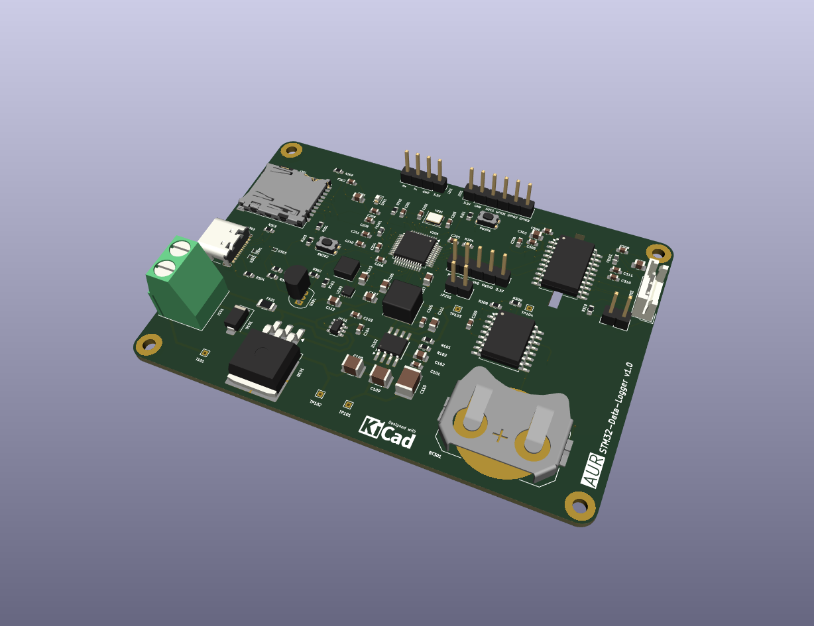
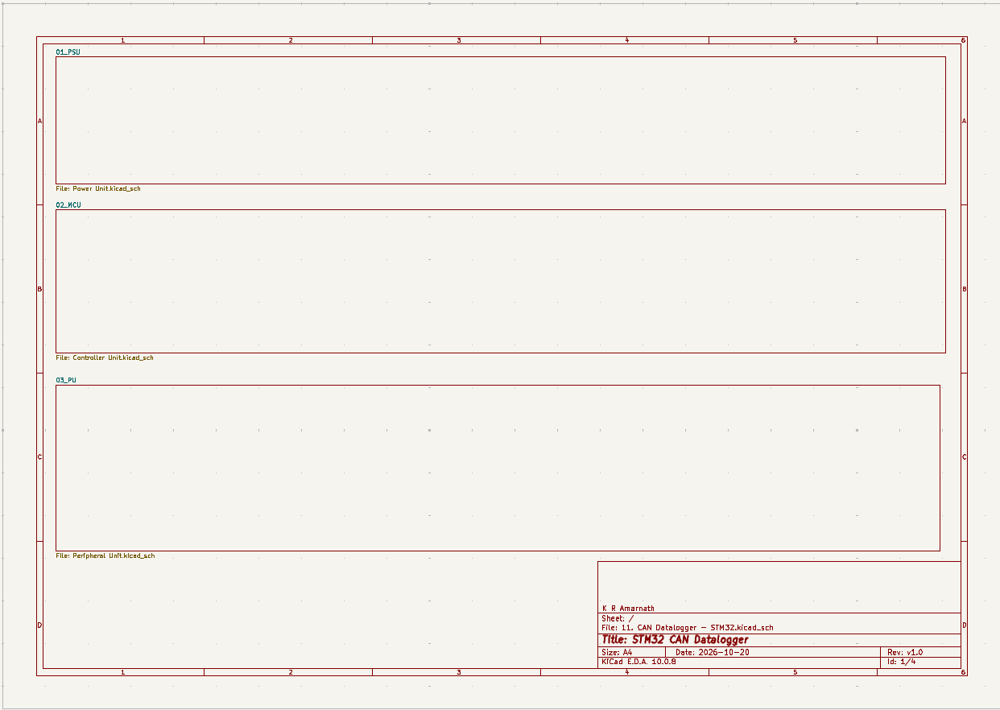
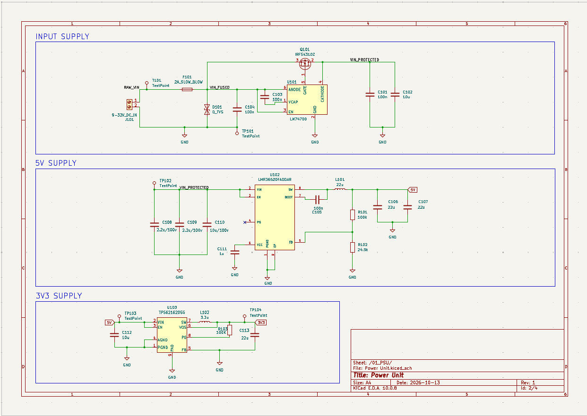
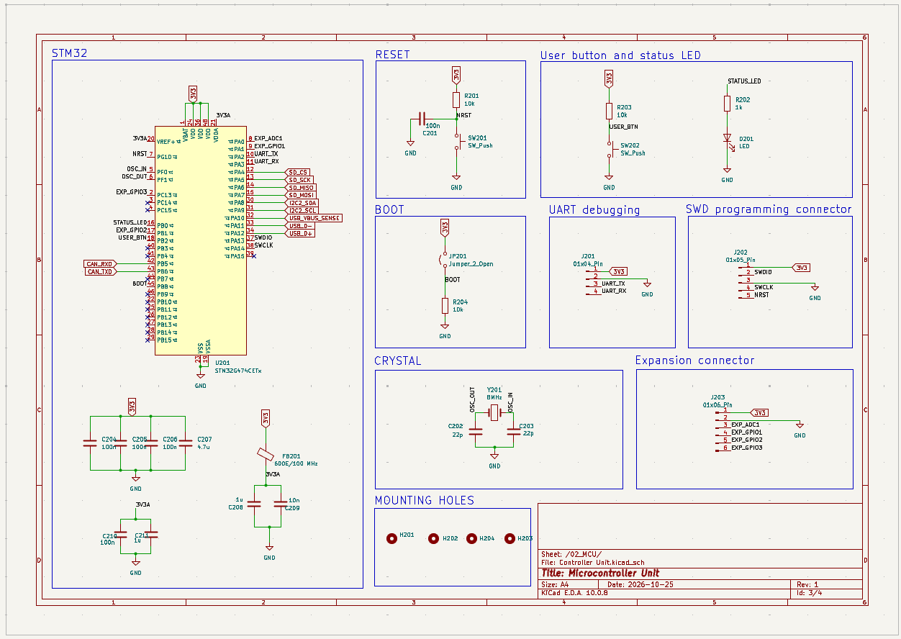
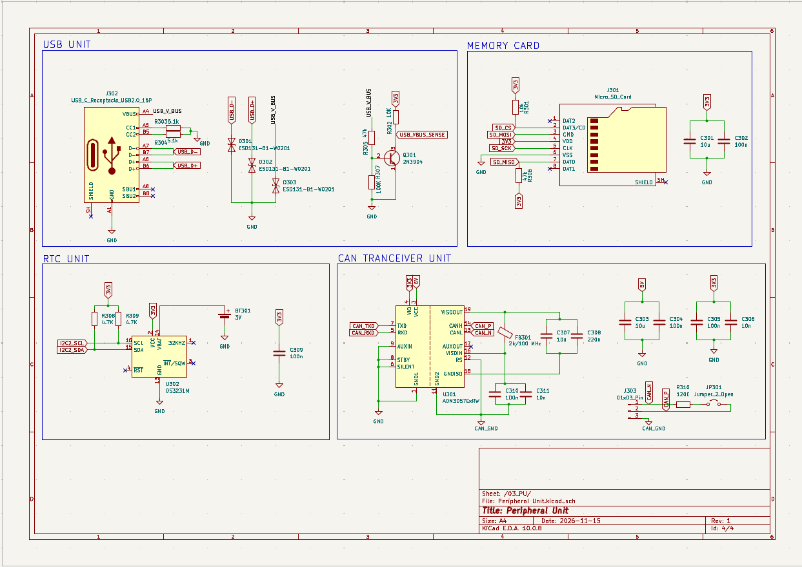
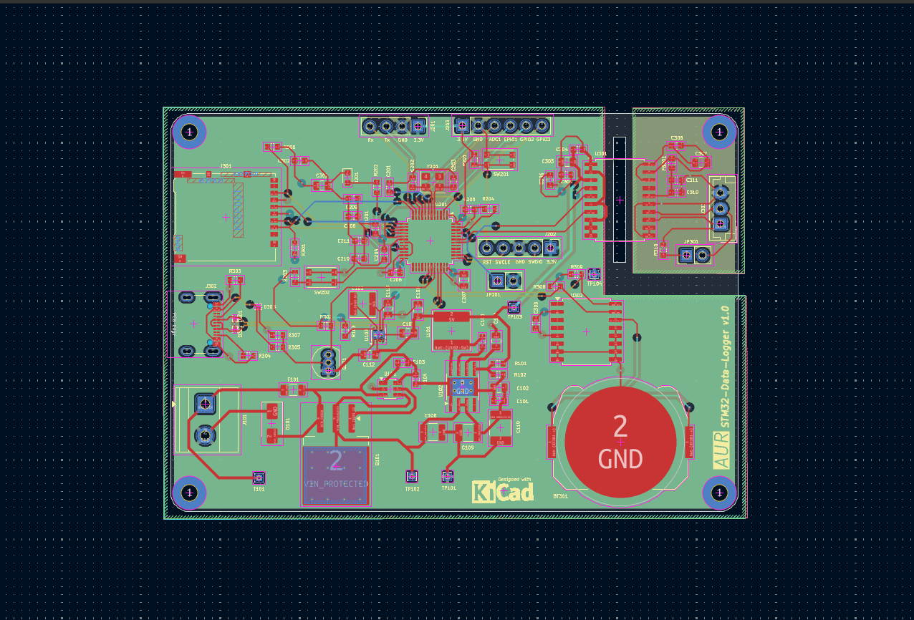
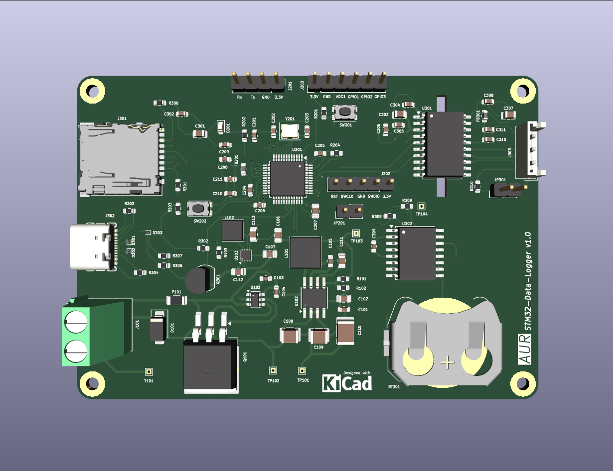
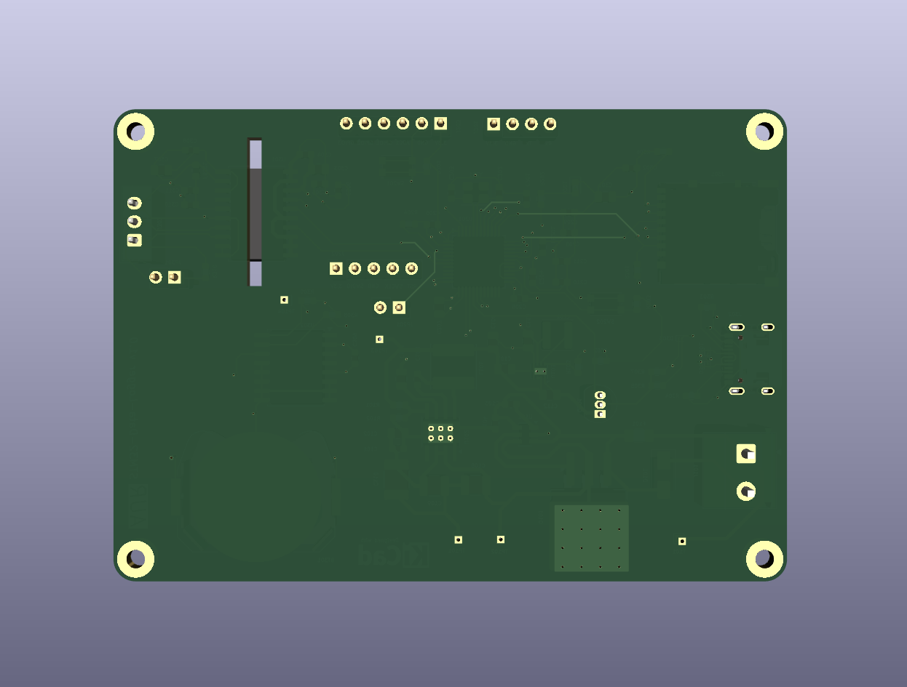

# STM32 CAN Data Logger

A 6-layer KiCad PCB for a **CAN FD data logger** built around an STM32G474 microcontroller. It has an **isolated CAN FD transceiver**, a **9–32 V DC input** with reverse-polarity and surge protection, **microSD logging**, a **battery-backed real-time clock** and a **USB-C** port.

> **Status:** Design project. The schematic and layout are complete and the KiCad Design Rules Check (DRC) passes with no errors. Gerber files are generated.
> The board has **not been manufactured**, so it has not been tested on hardware.



---

## Table of Contents

1. [Description](#1-description)
2. [Repository Structure](#2-repository-structure)
3. [Features](#3-features)
4. [Specifications](#4-specifications)
5. [Simple Working Explanation](#5-simple-working-explanation)
6. [How to Use and Flashing the Firmware](#6-how-to-use-and-flashing-the-firmware)
7. [PCB Images](#7-pcb-images)
8. [License](#8-license)

---

## 1. Description

This project is a compact data logger for CAN bus networks. An **STM32G474** reads frames from the CAN bus through an **ADM3057E isolated CAN FD transceiver** and stores them on a **microSD card**, with each record timestamped by a **DS3231M real-time clock** that keeps time from a coin cell when main power is off.

The board runs from a **9–32 V DC** supply, so it can sit on a vehicle or industrial 12 V or 24 V system. The input stage has a fuse, a TVS diode and an ideal-diode reverse-polarity circuit. Two buck converters generate the 5 V and 3.3 V rails.

I designed it as a learning and portfolio project to practise:

- Power-stage design for a wide input range.
- Isolating a bus from the logic side.
- Multi-layer stackup and plane planning.
- Placement and routing of mixed power, digital and USB signals in KiCad.

---

## 2. Repository Structure

```text
.
├── docs/
│   ├── schematic.png      # Schematic
│   ├── layout.png         # Copper layers
│   ├── 3d_front.png       # 3D view, top
│   ├── 3d_back.png        # 3D view, bottom
│   └── BOM.csv            # Bill of materials
├── LICENSE
└── README.md
```

> The full component list is in [`docs/BOM.csv`](docs/BoM.csv).

---

## 3. Features

- **STM32G474CET6** (Arm Cortex-M4, 512 KB flash, 128 KB RAM) with native FDCAN.
- **Isolated CAN FD transceiver** (ADM3057E with integrated isolated DC-DC). The bus side has its own ground (`CAN_GND`) and sits behind a routed isolation slot.
- **Selectable 120 Ω bus termination** with a jumper (JP301).
- **9–32 V DC input** with:
  - 2 A slow-blow fuse.
  - TVS diode.
  - LM74700 ideal-diode controller with an IRFS4310Z N-channel MOSFET for reverse-polarity protection.
- **5 V rail** from an LMR36520 buck converter, and **3.3 V rail** from a TPS62162 buck converter.
- **microSD card** socket (SPI mode) for logging.
- **DS3231M** I²C real-time clock with coin cell backup.
- **USB-C** receptacle (USB 2.0 full-speed) with ESD protection and VBUS sensing.
- **Headers:** SWD (J202), UART (J201) and an expansion header with 1 ADC and 3 GPIO pins (J203).
- Reset button, user button and a status LED.
- Boot-mode jumper (JP201) for USB DFU programming.
- Test points and four mounting holes.

---

## 4. Specifications

| Parameter | Value |
|---|---|
| Microcontroller | STM32G474CETx (LQFP-48) |
| Clock source | 8 MHz crystal |
| Input voltage | 9–32 V DC (screw terminal J101) |
| Input protection | 2 A slow-blow fuse, TVS diode, ideal-diode reverse-polarity protection |
| 5 V rail | LMR36520, up to 2 A (shared with the isolated CAN supply and the 3.3 V converter) |
| 3.3 V rail | TPS62162, up to 1 A |
| CAN | CAN FD via FDCAN, ADM3057E isolated transceiver |
| CAN connector | JST EH 3-pin (CAN_N, CAN_P, CAN_GND) |
| Storage | microSD (Hirose DM3AT), SPI mode |
| RTC | DS3231M with coin cell holder |
| USB | USB-C 2.0, full-speed device |
| Debug | SWD 5-pin header |
| Board size | 90.8 mm × 63.7 mm |
| Layers | 6 |
| Design tool | KiCad 10.0 |

**Layer use**

| Layer | Use |
|---|---|
| F.Cu | Components, main signal routing |
| In1.Cu | GND plane, plus a separate `CAN_GND` island on the bus side |
| In2.Cu | Signal routing |
| In3.Cu | 3V3 plane, some power routing |
| In4.Cu | GND plane, plus a separate `CAN_GND` island on the bus side |
| B.Cu | Power pour under the MOSFET, a few routes |

---

## 5. Simple Working Explanation

1. **Power in.** 9–32 V DC enters through J101. It passes the fuse and TVS diode, then through the LM74700 and IRFS4310Z, which block current if the supply is connected backwards and waste far less power than a diode.
2. **Power rails.** The LMR36520 steps the input down to 5 V. The TPS62162 then makes 3.3 V from the 5 V rail for the microcontroller and other logic.
3. **Reading CAN.** The CAN bus connects to J303. The ADM3057E isolates the bus from the rest of the board, with a slot cut in the PCB under the chip and separate ground copper on each side. The STM32's FDCAN peripheral exchanges frames with it through CAN_TXD and CAN_RXD.
4. **Logging.** The STM32 stamps each frame with the time from the DS3231M and writes it to the microSD card over SPI. The coin cell keeps the clock running when the board is off.
5. **Everything else.** The USB-C port connects the board to a PC (for example, to flash it over DFU), the status LED and user button give simple feedback, and the headers expose UART, SWD and spare GPIO/ADC pins.

---

## 6. How to Use and Flashing the Firmware

> The firmware is **not included yet**. Add a link or folder here when it is ready: `Firmware/` or `[link]`.

### Hardware setup

1. Connect a **9–32 V DC** supply to **J101** (pin 1 = positive, pin 2 = GND).
2. Insert a formatted **microSD card** into J301.
3. Fit a **coin cell** in BT301 so the RTC keeps time.
4. Connect the CAN bus to **J303** (CAN_N, CAN_P, CAN_GND).
5. Fit a jumper on **JP301** only if this board is at the end of the bus and needs the 120 Ω termination.

---

## 7. PCB Images

### Schematic

<div align="center">
  <table>
    <tr>
      <td align="center">
        <br>
        <b>Schematic 1</b>
      </td>
      <td align="center">
        <br>
        <b>Schematic 2</b>
      </td>
      <td align="center">
        <br>
        <b>Schematic 3</b>
      </td>
      <td align="center">
        <br>
        <b>Schematic 4</b>
      </td>
    </tr>
  </table>
</div>

### Layout

<div align="center">
  <table>
    <tr>
      <td align="center">
        <br>
        <b>Layout</b>
      </td>
    </tr>
  </table>
</div>

### 3D Model

<div align="center">
  <table>
    <tr>
      <td align="center">
        <br>
        <b>PCB 3D Image-1</b>
      </td>
      <td align="center">
        <br>
        <b>PCB 3D Image-2</b>
      </td>
    </tr>
  </table>
</div>

---

## 8. License

This project is released under the **MIT License**. See [LICENSE](LICENSE) for details.

---

*Designed with KiCad. Board version: STM32-Data-Logger v1.0.*
